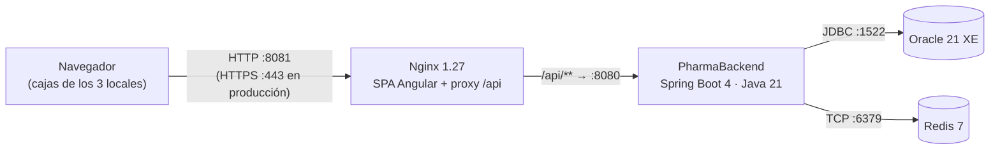

# PharmaFrontend

This project was generated using [Angular CLI](https://github.com/angular/angular-cli) version 22.2.1.

## Development server

To start a local development server, run:

```bash
ng serve
```

Once the server is running, open your browser and navigate to `http://localhost:4200/`. The application will automatically reload whenever you modify any of the source files.

## Code scaffolding

Angular CLI includes powerful code scaffolding tools. To generate a new component, run:

```bash
ng generate component component-name
```

For a complete list of available schematics (such as `components`, `directives`, or `pipes`), run:

```bash
ng generate --help
```

## Building

To build the project run:

```bash
ng build
```

This will compile your project and store the build artifacts in the `dist/` directory. By default, the production build optimizes your application for performance and speed.

## Running unit tests

To execute unit tests with the [Vitest](https://vitest.dev/) test runner, use the following command:

```bash
ng test
```

## Running end-to-end tests

For end-to-end (e2e) testing, run:

```bash
ng e2e
```

Angular CLI does not come with an end-to-end testing framework by default. You can choose one that suits your needs.

## Additional Resources

For more information on using the Angular CLI, including detailed command references, visit the [Angular CLI Overview and Command Reference](https://angular.dev/tools/cli) page.

## Despliegue en producción

### Arquitectura



| Pieza | Puerto | Función |
|---|---|---|
| Nginx | 8081 → 80 (443 con HTTPS) | Sirve `dist/pharma-frontend/browser` y reenvía `/api/**` al backend |
| PharmaBackend | 8080 | API REST, solo accesible desde Nginx |
| Oracle | 1522 | Base de datos |
| Redis | 6379 | Caché de categorías y productos |

La SPA llama al API con una ruta relativa (`/api/v1/...`), en el mismo origen que Nginx, así que no hace falta CORS.

### Políticas de caché de Nginx

| Recurso | `Cache-Control` | Motivo |
|---|---|---|
| `index.html` y rutas de la SPA | `no-cache` | Siempre se revalida y apunta a los archivos de la versión vigente |
| `main-*.js`, `chunk-*.js`, `styles-*.css` | `public, max-age=31536000, immutable` | El nombre lleva un hash: si el contenido cambia, cambia el nombre |
| `/api/**` | lo define el backend (`no-cache, no-store`) | Datos privados y cambiantes |

### Variables y configuración

El frontend no usa secretos. La configuración de compilación está en `src/environments/`:

| Archivo / variable | Propósito | Valor en producción |
|---|---|---|
| `environment.ts` → `apiUrl` | Base del API | `/api/v1` (relativa, mismo origen que Nginx) |
| Contenedor `web`: puerto publicado | Puerto de entrada de los locales | `443` con HTTPS (`8081` en el laboratorio) |
| Volumen de Nginx | Carpeta servida | `dist/pharma-frontend/browser` → `/usr/share/nginx/html` |

### Construir y desplegar

```bash
# 1. Etiquetar la versión
git checkout main && git pull
git tag v1.3.0 && git push origin v1.3.0

# 2. Construir
npm ci
ng build                      # genera dist/pharma-frontend/browser

# 3. Conservar la versión anterior
cp -r /opt/pharmasoft/web /opt/pharmasoft/web.prev

# 4. Publicar sin detener Nginx
rsync -a --delete dist/pharma-frontend/browser/ /opt/pharmasoft/web/

# 5. Verificar
curl -I https://<servidor>/index.html      # Cache-Control: no-cache
```

No hace falta reiniciar Nginx. Los usuarios reciben la versión nueva en su siguiente recarga, porque `index.html` se revalida y apunta a los archivos con hash nuevos. Los archivos que no cambiaron se siguen tomando de la caché del navegador.

### Volver a la versión anterior

```bash
rsync -a --delete /opt/pharmasoft/web.prev/ /opt/pharmasoft/web/
```

Basta con restaurar la carpeta anterior. Su `index.html` vuelve a apuntar a los archivos con hash de esa versión.

### Estado de las buenas prácticas

| Buena práctica | Estado | Evidencia / acción pendiente |
|---|---|---|
| Features con `loadChildren` (carga diferida) | ✅ Cumple | Chunks `*-routes` separados (Parte A) |
| Bloques `@defer` para lo que no se ve al inicio | ✅ Cumple | Reporte de más vendidos y comprobante de impresión diferidos (Parte A) |
| Precarga de features justificada con cifras | ✅ Cumple | `PreloadAllModules`, comparado con y sin precarga (Parte A) |
| Archivos con hash `immutable` | ✅ Cumple | `curl -I` de `main`, chunks y `styles` (Parte B) |
| `index.html` con `no-cache` | ✅ Cumple | Despliegue simulado sin borrar la caché (Parte B) |
| Compresión gzip | ✅ Cumple | `Content-Encoding: gzip` |
| Código de seguimiento en los mensajes de error | ✅ Cumple | `errorInterceptor` agrega «Código de seguimiento: xxxxxxxx» |
| Sesión cerrada ante un 401 | ✅ Cumple | `errorInterceptor` → `cerrarSesion('expirada')` |
| Presupuesto de tamaño en `angular.json` | ✅ Cumple | `budgets` configurados: el build avisa o falla si el inicial crece |
| HTTPS | ❌ No cumple | **Acción:** certificado en Nginx y redirección 80 → 443 |
| Cabeceras de seguridad en Nginx (CSP, HSTS) | ⚠️ Parcial | El API las envía; **acción:** agregarlas también a los archivos estáticos |

### Recomendaciones para los tres locales

1. **HTTPS y un único servidor central (prioridad alta).** Los tres locales entran a la misma URL `https://`, con un solo Nginx, un solo backend y un solo Redis. Así todos ven el mismo stock y los mismos precios al instante, y el token y las contraseñas viajan cifrados.
2. **Copias de seguridad de Oracle (prioridad alta).** Hacerlas a diario y antes de cada despliegue, y probar la restauración una vez al mes. El frontend se reconstruye desde Git, pero las ventas no.
3. **Alertas sobre `/actuator/health` (prioridad media).** Un monitor que avise ante un `503`. Además, el código de seguimiento que muestra la SPA permite que el personal del local reporte un error y soporte lo encuentre en el log con `grep`.